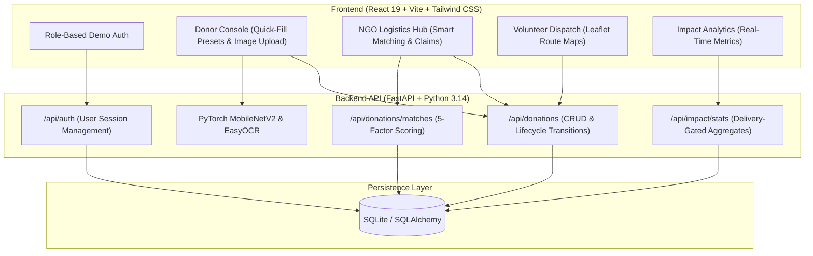
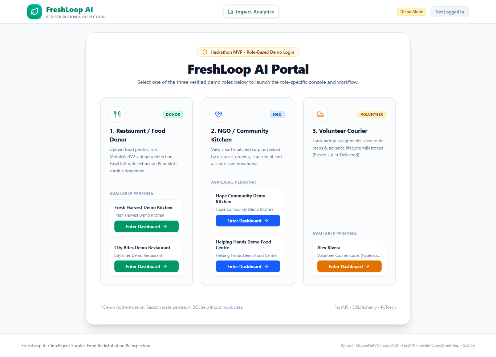
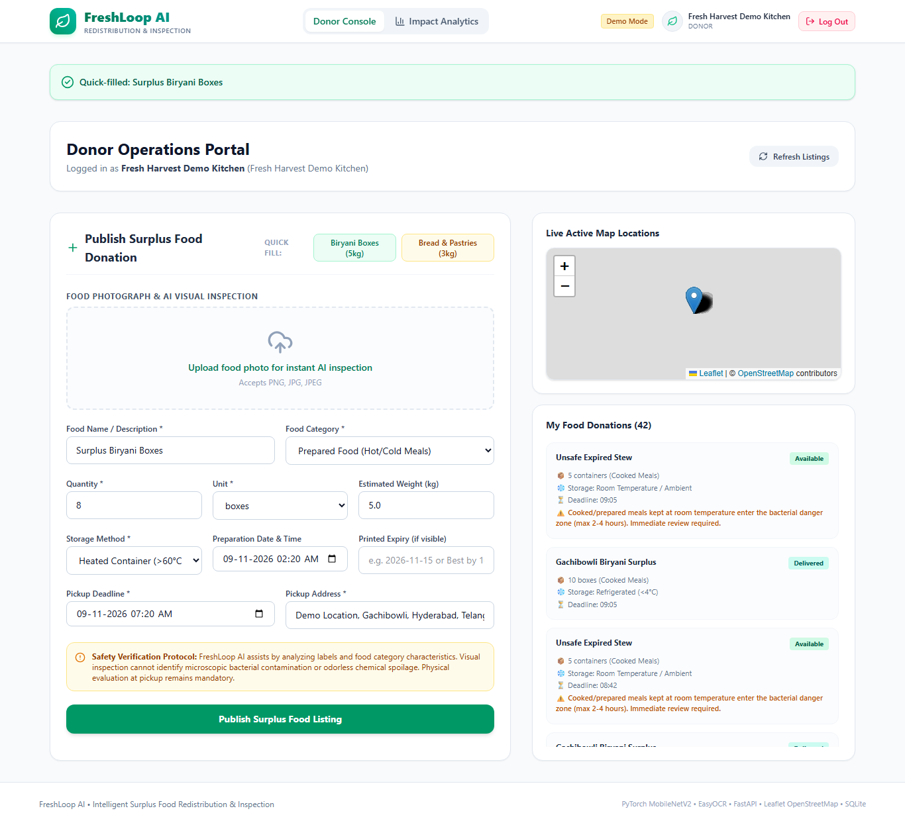
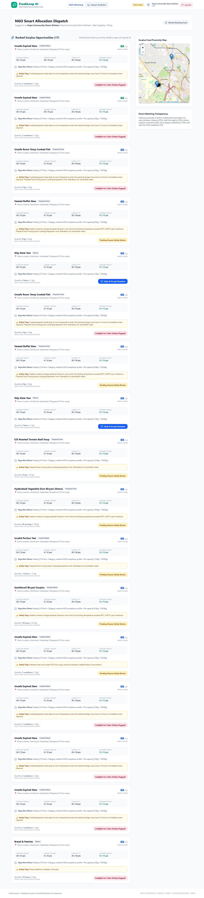
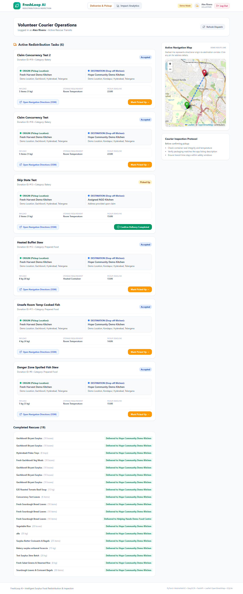
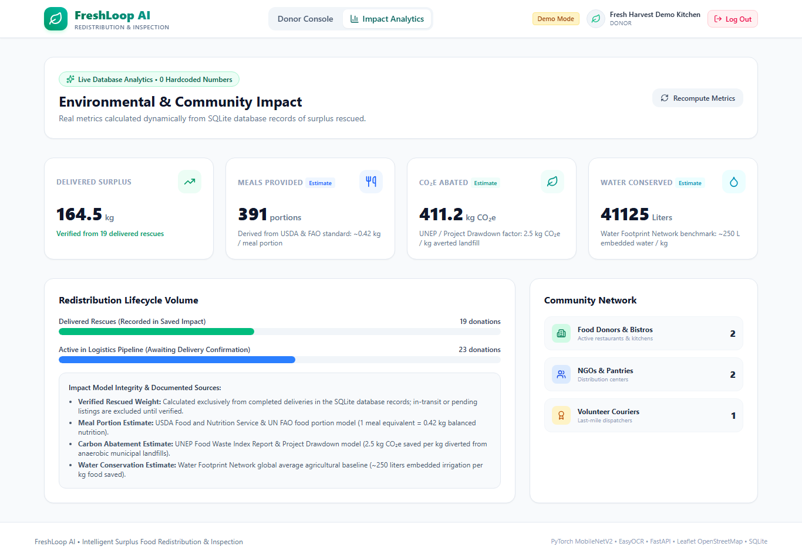
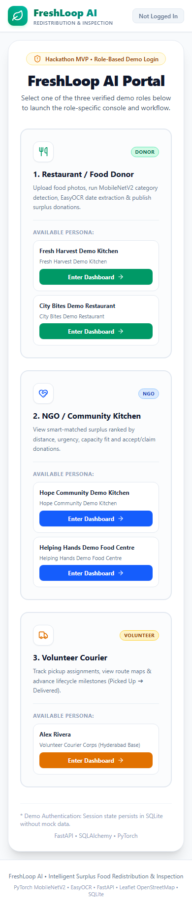

# FreshLoop AI 🥗🔄

**AI-Assisted Food Classification & Intelligent Surplus Food Redistribution Platform**

FreshLoop AI connects commercial kitchens and restaurants with verified NGOs, community kitchens, and volunteer couriers to streamline real-time surplus food recovery across the Hyderabad Cyberabad tech corridor. The platform features automated computer vision category prediction, label date recognition, urgency-weighted multi-factor matching, and live impact tracking.

---

## 1. Problem Statement

Urban commercial kitchens, banquet halls, and food service establishments frequently generate high-quality surplus meals that risk being discarded due to:
- Tight operational turnaround windows and short food shelf-life.
- Friction in manually categorizing, logging, and verifying food batches.
- Lack of visibility into nearby receiving community kitchens with matching storage capacity.
- Decentralized, uncoordinated volunteer courier dispatching without map guidance.

---

## 2. Proposed Solution

FreshLoop AI provides an end-to-end, role-based platform that coordinates the complete food rescue lifecycle:
1. **Donor Workflow:** Instant surplus listing with Quick-Fill presets, PyTorch MobileNetV2 category detection, EasyOCR label recognition, and mandatory food safety checklists.
2. **NGO Allocation:** Smart multi-factor ranking (0–100 points) evaluating distance, time-to-deadline urgency, and kitchen capacity constraints.
3. **Volunteer Courier Dispatch:** Interactive Leaflet route maps displaying origin and destination pins with direct OpenStreetMap turn-by-turn navigation.
4. **Impact Engine:** Real-time environmental and community impact accounting strictly gated to completed deliveries.

---

## 3. Key Features

- **Quick-Fill Demo Presets:** Pre-populate standard surplus portion weights (e.g., 8 boxes / 5.0 kg of Biryani or 12 boxes / 3.0 kg of bakery items) with one click to streamline live operations.
- **AI-Assisted Visual Inspection:** PyTorch MobileNetV2 image classification provides real-time category suggestions and confidence ratings, while EasyOCR reads printed package dates.
- **Responsible AI Food Safety Architecture:** Clear separation between visual category identification and physical safety verification; visual AI assists metadata entry but never claims pathogen detection.
- **Smart 5-Factor NGO Matching:** Mathematical ranking based on Haversine distance, expiration urgency, weight-to-capacity utilization, food category rules, and real-time NGO availability.
- **Concurrency & State Machine Integrity:** Atomic database transactions and HTTP 409 Conflict protections prevent duplicate claims across multiple NGOs.
- **Dual Map Navigation:** Interactive Leaflet map displaying both pickup and delivery locations with dashed visual connectors and OpenStreetMap route links.
- **Delivery-Gated Impact Analytics:** Dynamically calculated rescued food weights, meal equivalents (0.42 kg/meal illustrative assumption), CO₂e emissions avoided (2.5 kg/kg), and embedded water saved (250 L/kg).

---

## 4. Technology Stack

- **Frontend:** React 19, Vite, Tailwind CSS v4, Lucide React Icons
- **Mapping & GIS:** Leaflet, OpenStreetMap (`react-leaflet`)
- **Backend:** Python 3.14, FastAPI, Pydantic v2, Uvicorn
- **Database & ORM:** SQLite with SQLAlchemy ORM (local persistent file)
- **Computer Vision:** PyTorch, Torchvision (`MobileNet_V2`), OpenCV, Pillow
- **Optical Character Recognition:** EasyOCR
- **Testing & Automation:** Playwright Chromium (end-to-end browser automation)

---

## 5. System Architecture



---

## 6. User Roles and Workflows

FreshLoop AI models three distinct operational roles active within the Hyderabad Cyberabad corridor:

```
[Donor: Commercial Kitchen] ──(Publishes Surplus)──> [Available Listing]
                                                            │
[NGO: Community Pantry]     ──(Claims via Score)───> [Accepted Listing]
                                                            │
[Volunteer Courier]         ──(Picks Up & Delivers)─> [Delivered Batch]
                                                            │
                                                     [Impact Dashboard Updates]
```

### 1. Restaurant / Food Donor
- Logs surplus food batches with exact portion counts, packaging types, and storage methods (Heated, Refrigerated, Frozen, Room Temperature).
- Uses **Quick-Fill Presets** or uploads genuine photographs for automated visual category suggestions and label date extraction.
- Completes mandatory food safety hygiene checklist before publishing.

### 2. NGO / Community Kitchen
- Discovers available food donations filtered and ranked by proximity and time-to-deadline urgency.
- Inspects food safety self-reports and storage flags.
- Claims eligible donations with concurrency protection preventing duplicate claims.

### 3. Volunteer Courier
- Volunteers can see their assigned pickups on the dashboard.
- Views both pickup origin and drop-off destination on an interactive Leaflet map.
- Advances the shipment lifecycle through structured milestones: `Accepted` ➔ `Mark as Picked Up` ➔ `Mark as Delivered`.

---

## 7. AI Inspection Methodology & Limitations

### Computer Vision & OCR
- **Category Classification:** PyTorch `MobileNet_V2` pretrained ImageNet model inspects image characteristics to suggest food categories (`Prepared Food`, `Produce / Vegetables`, `Bakery`, `Dairy`, `Packaged / Pantry`) with associated confidence scores.
- **Label Text Extraction:** EasyOCR parses visible expiry and best-before dates from packaging labels.

### Model Scope & ImageNet Limitations
> [!NOTE]
> **Pretrained Weights & Food Label Specifics:**
> The underlying PyTorch classifier utilizes standard pretrained ImageNet-1K weights (`MobileNet_V2_Weights.DEFAULT`), which include general food-adjacent classes (such as `bagel`, `pretzel`, `pizza`, `bakery`, `tray`, etc.) but was **not trained on Indian regional dishes**. Consequently, regional meals like biryani, curry, or dal cannot be recognized reliably and may yield generic classes (e.g., `tray`) or `Needs Manual Confirmation`. Donors must verify or manually adjust the suggested category.

### Food Safety Limitations & Responsible AI Disclaimer
> [!IMPORTANT]
> **Safety Verification Protocol:**
> FreshLoop AI assists human operators by categorizing items and extracting printed text. **Visual inspection cannot identify microscopic bacterial pathogens (e.g., *Salmonella*, *Listeria*, *E. coli*), chemical toxins, or odorless spoilage.** Physical sensory evaluation and temperature checks by the receiving organization at pickup remain mandatory.

---

## 8. Smart NGO Matching Algorithm

The redistribution engine computes a multi-factor score ($0$ to $100$ points) for every active donation evaluated against registered NGOs:

$$\text{Composite Score} = S_{\text{dist}} + S_{\text{urg}} + S_{\text{cap}} + S_{\text{cat}} + S_{\text{avail}}$$

| Factor | Weight | Evaluation Criteria |
| :--- | :---: | :--- |
| **1. Proximity / Distance** | **35 pts** | Haversine formula: $\le 2\text{ km} \to 35\text{ pts}$; $\le 5\text{ km} \to 28\text{ pts}$; $\le 10\text{ km} \to 18\text{ pts}$; $\le 20\text{ km} \to 8\text{ pts}$; $>20\text{ km} \to 0\text{ pts}$. |
| **2. Pickup Urgency** | **25 pts** | Remaining shelf life: $<2\text{ hours} \to 25\text{ pts}$; $2-6\text{ hours} \to 20\text{ pts}$; $6-12\text{ hours} \to 14\text{ pts}$; $>12\text{ hours} \to 8\text{ pts}$. |
| **3. Capacity Utilization** | **20 pts** | Matches donation weight against NGO capacity. If weight $\le$ capacity: $20\text{ pts}$ (if $\le 85\%$ capacity) or $12\text{ pts}$; exceeds capacity: $0\text{ pts}$. |
| **4. Category Fit** | **15 pts** | Evaluates receiving kitchen dietary acceptance flags (hot cooked meals, produce, bakery, pantry). Compatible: $15\text{ pts}$; Incompatible: $0\text{ pts}$. |
| **5. Kitchen Availability** | **5 pts** | Operational readiness flag of receiving facility: Available $\to 5\text{ pts}$; Offline $\to 0\text{ pts}$. |

---

## 9. Volunteer Courier Workflow & Mapping

- **Leaflet & OpenStreetMap Integration:** Displays green pickup origin markers and red destination drop-off markers.
- **Route Visual Connector:** A dashed connector line visualizes origin-destination pairs.
- **Navigation External Link:** A direct link opens OpenStreetMap directions using the exact Hyderabad GPS coordinates.
- **State Machine Safeguards:** Status changes are strictly sequential (`Accepted` ➔ `Picked Up` ➔ `Delivered`). Premature or duplicate status jumps are rejected by the API.

---

## 10. Impact Calculation Methodology

Impact metrics reflect real database records and are **strictly gated to donations with status `Delivered`**:

- **Rescued Food:** $\sum \text{estimated\_kg}$ of all donations where $\text{status} = \text{'Delivered'}$ (based on donor-entered estimated weight).
- **Meal Equivalents:** $\text{Rescued Food (kg)} \div 0.42\text{ kg/meal}$ (illustrative estimated conversion assumption of 0.42 kg per meal equivalent).
- **CO₂e Emissions Avoided:** $\text{Rescued Food (kg)} \times 2.5\text{ kg CO}_2\text{e/kg}$ (illustrative estimated conversion assumption of 2.5 kg CO₂e avoided per kg food diverted).
- **Embedded Water Conserved:** $\text{Rescued Food (kg)} \times 250\text{ L/kg}$ (illustrative estimated conversion assumption of 250 L embedded water saved per kg food).

> [!NOTE]
> Pledged, available, or in-transit donations do not increment impact totals until delivery is confirmed. These conversion factors are illustrative estimated conversion assumptions used for prototype impact calculations and are model-derived estimates rather than direct measurements or independently verified environmental outcomes.

---

## 11. Hyderabad Demo Accounts & Personas

FreshLoop AI includes built-in demo authentication with fictional Hyderabad Cyberabad personas for evaluation:

| Role | Persona Name | Location | Demo Coordinates |
| :--- | :--- | :--- | :--- |
| **Donor 1** | Fresh Harvest Demo Kitchen | Gachibowli, Hyderabad | `17.4401° N, 78.3489° E` |
| **Donor 2** | City Bites Demo Restaurant | Madhapur, Hyderabad | `17.4483° N, 78.3915° E` |
| **NGO 1** | Hope Community Demo Kitchen | Kondapur, Hyderabad | `17.4697° N, 78.3657° E` |
| **NGO 2** | Helping Hands Demo Food Centre | HITEC City, Hyderabad | `17.4435° N, 78.3772° E` |
| **Volunteer** | Alex Rivera | Courier Hub, Gachibowli | `17.4401° N, 78.3489° E` |

---

## 12. Installation & Setup Instructions (Windows)

### Prerequisites
- **Python:** 3.10+ (tested on Python 3.14)
- **Node.js:** 18+ and `npm`
- **Git**

### Step 1: Clone the Repository
```powershell
git clone https://github.com/sai234teja/FrehLoop-AI.git
cd "FrehLoop-AI"
```

### Step 2: Backend Setup
```powershell
# From the project root, navigate to backend directory
cd backend

# Create virtual environment
python -m venv venv

# Activate virtual environment
.\venv\Scripts\Activate.ps1

# Install required dependencies
pip install -r requirements.txt

# Seed initial database (run with Python module resolution)
python -m app.seed_data

# Start FastAPI backend server
python -m uvicorn app.main:app --host 127.0.0.1 --port 8000
```
*Backend runs at:* `http://127.0.0.1:8000`
*Interactive Swagger API Documentation:* `http://127.0.0.1:8000/docs`

### Step 3: Frontend Setup
```powershell
# In a new PowerShell terminal, navigate to frontend
cd frontend

# Install npm dependencies
npm install

# Start Vite dev server
npm run dev -- --host 127.0.0.1
```
*Frontend runs at:* `http://127.0.0.1:5173`

---

## 13. Testing Instructions

### Reproducible Repository Verification Checks
From a clean checkout, the following verification commands can be run directly:

1. **Backend Python Compilation Check:**
   ```powershell
   cd backend
   python -m compileall app
   ```
2. **Frontend Production Build Verification:**
   ```powershell
   cd frontend
   npm run build
   ```
3. **Backend Health Check:**
   With Uvicorn running on port 8000:
   ```powershell
   curl.exe http://127.0.0.1:8000/api/health
   curl.exe http://127.0.0.1:8000/api/stats/impact
   ```

> [!NOTE]
> **Historical Test Suite Distinction:**
> Development regression test scripts (`test_p1_suite.py`) were used during the P0/P1 development sprints to validate state machine transitions and concurrency locks. Those test harness files are excluded from the git repository and submission package via `.gitignore`. Their historical validation logs are archived in `docs/internal/`. Do not expect `test_p1_suite.py` to be present in a fresh clone.

---

## 14. Prototype Scope vs Planned Architecture

### Currently Implemented in Prototype:
- **Frontend:** Single Page Application built with React 19, Vite, Tailwind CSS v4, Lucide React, and Leaflet maps.
- **Backend:** FastAPI REST API with structured Pydantic schemas, dependency injection, and CORS middleware.
- **Database & Storage:** Local SQLite database with SQLAlchemy ORM models.
- **Authentication:** Demo persona selector allowing immediate evaluation of 5 verified Hyderabad personas without friction.
- **Security Scope:** The prototype does **not** include production passwords, JWT token issuance, session cookies, or cryptographic access controls.
- **AI Inference:** Pretrained MobileNetV2 for ImageNet visual category suggestions and EasyOCR for printed expiry extraction executed server-side in FastAPI.

### Planned Production Architecture:
- **Managed Database & Auth:** Supabase (PostgreSQL) integration for scalable cloud data hosting and Row Level Security (RLS).
- **Authentication & RBAC:** Supabase Auth / JWT-based OAuth2 authentication with encrypted session tokens and verified role-based access control (RBAC).
- **Automated Dispatch:** WhatsApp Business API / Twilio SMS webhooks for automated volunteer dispatch alerts.

---

## 15. Prototype Screenshots

Genuine screenshots captured using Playwright Chromium at desktop (1366 × 768) and mobile (390 × 844) viewports:

| Desktop Login Portal | Donor Console & Quick-Fill Presets |
| :---: | :---: |
|  |  |

| NGO Logistics & Smart Matching | Volunteer Courier Dispatch & Leaflet Map |
| :---: | :---: |
|  |  |

| Live Impact Analytics Tracker | Mobile Responsive View (390 × 844) |
| :---: | :---: |
|  |  |

---

## 16. Future Roadmap

1. **IoT Temperature Logging:** Integrate Bluetooth Low Energy (BLE) temperature data loggers to monitor hot-holding and cold-chain compliance during transit.
2. **Dynamic Route Clustering:** Multi-stop pickup batching algorithms for volunteer couriers collecting from multiple restaurants along a corridor.
3. **Automated WhatsApp / SMS Dispatch:** Instant notification alerts for NGOs and volunteers when high-urgency surplus is published nearby.
4. **FSSAI Compliance Reporting:** Exportable food safety audit logs aligning with national food donation safety regulations.

---

## 17. Contributors & Acknowledgements

- **Developer:** Sai Teja Gunda ([@sai234teja](https://github.com/sai234teja))
- **Frameworks & Libraries:** FastAPI, PyTorch, Torchvision, EasyOCR, Leaflet, OpenStreetMap, React, Tailwind CSS, Lucide Icons.
- **Reference Conversion Models:** Illustrative impact calculation models adapted from published food recovery literature.
